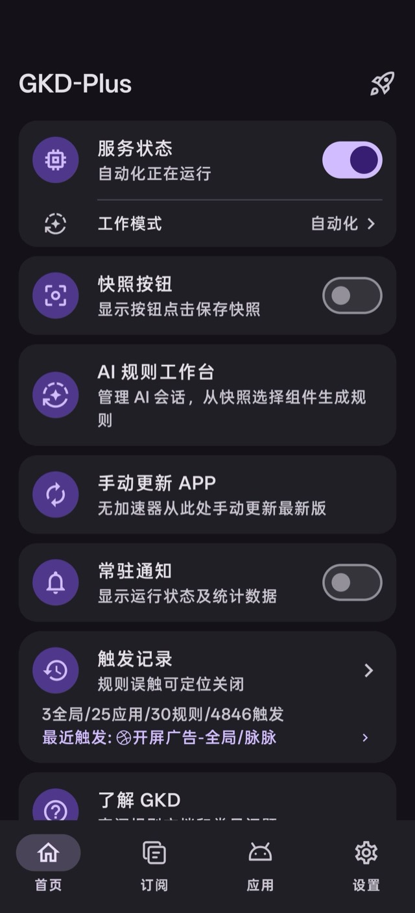
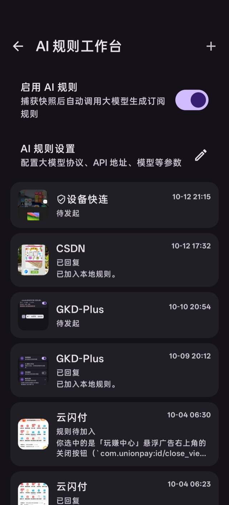
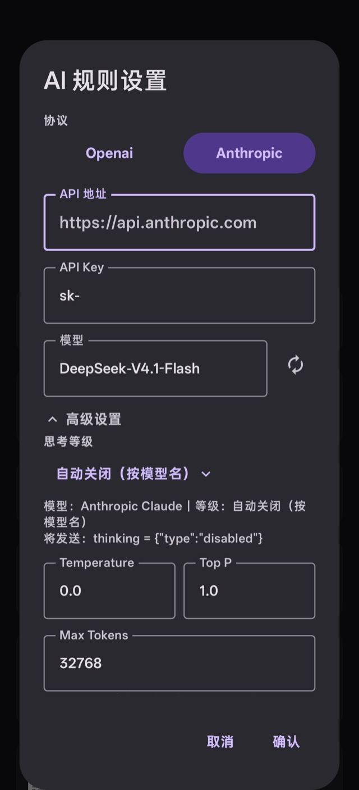
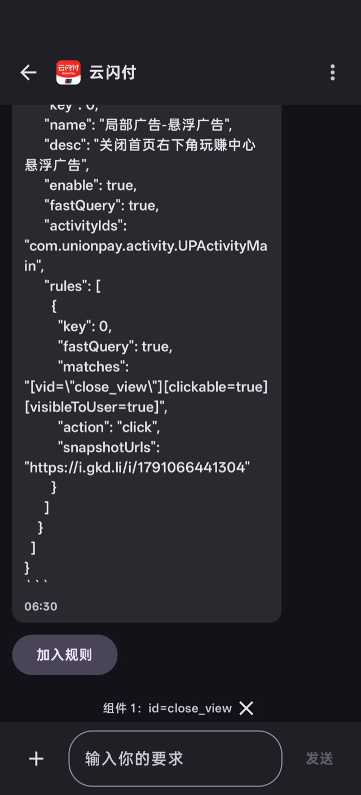
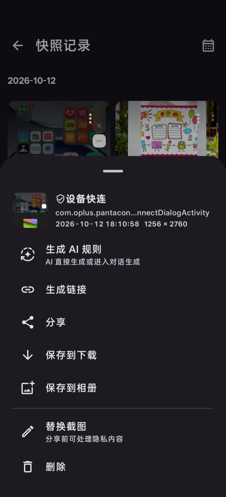

# GKD-Plus

[English](README_EN.md) | **简体中文**

  

  
  
  
  

GKD-Plus 是基于 [GKD](https://github.com/gkd-kit/gkd) 的增强分支，在原版基础上加入 AI 智能规则生成等能力。

GKD 是一个基于[高级选择器](https://gkd.li/guide/selector)、[订阅规则](https://gkd.li/guide/subscription) 与[快照审查](https://github.com/gkd-kit/inspect)的自定义屏幕点击 Android 应用：通过自定义规则，在指定界面满足指定条件（如屏幕上存在特定文字）时，点击特定节点或位置，或执行其他操作。

  
  
  

  
  
  

## 新增功能

### AI 智能规则生成

- 支持接入大模型（OpenAI / Anthropic 协议）自动生成点击规则，可自定义 API 地址、模型、温度等参数
- 快照选择器：可缩放选择范围、多选组件，可查看组件的具体属性，支持「直接生成」或「对话生成」
- AI 规则工作台：按应用保存会话，可回看历史、继续追问
- 多会话并发生成：不同快照各自独立处理、互不阻塞；同一会话重复触发会复用正在进行的任务
- 思考等级：按模型名自动匹配合适的思考参数（Claude / GPT-5 / 智谱 GLM / 豆包 / 千问 / DeepSeek 等），也支持手写自定义 JSON
- Max Tokens 自适应：预算偏小时自动抬底、输出被截断时翻倍、被服务端拒绝时回退并记住上限
- 设置页支持「测试连接」
- 推荐使用 Deepseek-v4-flash

### AI 配置备份/恢复

- 大模型配置（API URL、Key、模型等）纳入备份/导入体系

### 简易规则

参考李跳跳，不想写选择器时，可以在 `应用规则` 页点右下角展开按钮，选「简易规则」直接加一条：

- 填「文字」或「ID」其一即可生成规则，生成后追加到本地订阅的当前应用下
- 文字填界面上出现的文字（如「跳过」「关闭」「我知道了」），ID 填控件的 resource-id（如 `com.example:id/close`）；两者都填时优先按 ID 匹配
- 可选「通过返回键关闭」：开启后动作为返回键，关闭则点击匹配到的元素
- 同名规则自动加 `-2`、`-3` 后缀，不会覆盖已有规则

## 安装

从 [Releases](https://github.com/fjjzy/gkd-plus/releases/latest) 下载最新的 `gkd-*.apk` 安装即可。

也可以在应用内进入 `设置 - 关于 - 检查更新` 升级：GitHub 不可达时会自动回退到 Gitee 与 npm 镜像获取版本信息，并可经夸克网盘下载。

## 使用流程

1. **配置大模型**：在 `AI 规则工作台 - AI 规则设置` 里填好协议、API 地址、API Key 和模型，点「测试连接」确认能通。
2. **准备触发入口**（任选其一）：
   - 首页打开「快照按钮」，之后点悬浮球即可抓快照
   - 把控制中心的「捕获快照」磁贴加进来，下拉通知栏一键抓
   - 打开「音量快照」，按音量键自动抓
3. **在目标界面触发一次快照**。
4. **选组件**：在快照选择器里缩放选择范围、手动勾选需要的组件（可查看组件属性）；不选也可以直接生成。
5. **生成并入库**：点「直接生成」一键出规则并加入本地规则；或点「对话生成」，用自然语言补充要求，不满意就继续追问。
6. **后续调整**：回到 `AI 规则工作台` 找到这次会话，接着之前的对话继续改。

规则不局限于关闭广告。你可以直接描述想要的条件，比如「当组件 1 和组件 2 同时存在时，自动点击组件 3」，模型会把它翻译成 GKD 规则。

## 原版功能

- **快捷操作**：简化重复流程，如自动确认电脑登录
- **跳过流程**：自动跳过启动时的烦人流程

## 常见问题

规则生成失败时，请进入 `设置 - 关于 - 导出日志`，把日志发到 `3329221986@qq.com`，或在 [Issues](https://github.com/fjjzy/gkd-plus/issues) 反馈（请附日志，否则很难定位）。

使用上的疑问、功能想法和经验分享，欢迎到 [Discussions](https://github.com/fjjzy/gkd-plus/discussions) 交流。

如果是 AI 规则对话过程中出现的问题，可以在对话页右上角「更多」里选「转发分享当前对话」，把生成的文件发到 `3329221986@qq.com`，或提交到 [Issues](https://github.com/fjjzy/gkd-plus/issues) / [Discussions](https://github.com/fjjzy/gkd-plus/discussions)。

## 免责声明

本项目遵循 [GPL-3.0](/LICENSE) 开源，仅供学习交流，禁止用于商业或非法用途。

本项目是 GKD 的独立增强分支，不代表原项目官方立场。如需了解原版 GKD，请访问 [gkd-kit/gkd](https://github.com/gkd-kit/gkd)。
